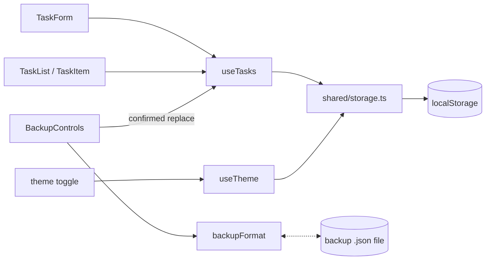

# odd-todo-app

A to-do list in React + TypeScript — and the actual subject of the repository: building it with an AI coding agent ([OpenCode](https://opencode.ai)) under a hand-made adaptation of **Organic Driven Development (ODD)**, where the process scales to what each request needs instead of a fixed ceremony. The rules live in [`AGENTS.md`](AGENTS.md); every feature was negotiated, tested and recorded in the open (see [odd/tasks/](odd/tasks/)).

## Features

What a user can do today (links to the spec each behavior comes from):

| Feature | Details | Limits |
|---|---|---|
| Add a task | input labeled "New task" + "Add"; Enter also adds; duplicates allowed | text is trimmed; empty → `Write a task first.`; over 120 chars (after trim) → `Keep it to 120 characters or fewer.` ([todo-core S1](odd/tasks/todo-core.md)) |
| See the list | newest task first | when empty: `No tasks yet.` (todo-core S2) |
| Complete a task | checkbox per task (named by the task text) | completed rows get line-through + muted color ([B5 tokens](AGENTS.md)); unchecking restores (todo-core S3) |
| Delete a task | "Delete" button per row, accessible name `Delete <task text>` | immediate, no confirmation (todo-core S4) |
| Persistence | tasks survive reloads in `localStorage` | stored as JSON under `odd-todo-app:tasks`; a corrupt or invalid stored value shows an empty list and is **not** rewritten until you change the list (todo-core S5) |
| Light/dark theme | follows the operating system; "Switch to dark/light theme" button overrides and persists (`odd-todo-app:theme`) | all colors are semantic tokens with WCAG-AA-verified contrast ([ui-policy](odd/tasks/ui-policy.md)) |
| Backup export | "Export tasks" downloads `odd-todo-backup-YYYY-MM-DD.json` (local date) | works with an empty list ([backup S1](odd/tasks/backup.md)) |
| Backup import | "Import tasks" picks a `.json` file; replaces the list **only after** you confirm `Replace current tasks (N) with imported tasks (M)?` (Replace/Cancel) | files > 1 MB, bad JSON, unknown format/version, or any task breaking the add rules are rejected whole: `This file can't be imported.` (backup S3) |

Explicitly **not** built (by decision, recorded in the docs): editing tasks, filters, reordering, counters, sync, undo, cloud or automatic backups.

## Getting started

No version pinning exists in the repo (`package.json` has no `engines`); this was built and last verified on **Node v26 · pnpm 12**.

```bash
git clone https://github.com/jmibann/odd-todo-app.git
cd odd-todo-app
pnpm install
pnpm dev                      # Vite dev server, http://localhost:5173
```

Commands (the canonical list is [AGENTS.md B4](AGENTS.md); each verified working at this commit):

| Purpose | Command |
|---|---|
| Unit tests, one file | `pnpm vitest run src/app/App.test.tsx` |
| Unit tests, suite | `pnpm test` |
| E2E (Chromium) | `pnpm exec playwright test` (needs one-time `pnpm exec playwright install chromium`) |
| Lint | `pnpm lint` |
| Typecheck | `pnpm exec tsc -b --force` |

## Architecture

Folder layout ([AGENTS.md B2](AGENTS.md)):

| Path | One line |
|---|---|
| `src/app/` | app composition and entry point (`main.tsx`, `App.tsx`, base styles) |
| `src/features/<feature>/` | components, hooks and tests for one feature (`todo`, `backup`) |
| `src/shared/hooks/` | hooks reused across features (`useTheme.ts`) |
| `src/shared/storage.ts` | **the only** access point to `localStorage` |
| `src/shared/styles/` | `tokens.css` + the tests that enforce the UI policy |
| `src/shared/<helper>.ts` | pure helpers reused across features (e.g. `taskText.ts`) |
| `e2e/` | Playwright specs |
| `odd/tasks/` | feature documents (specs, tasks, log) |

Main flow:



Key decisions, each defined in the repo:

| Decision | Why | Where |
|---|---|---|
| Single `localStorage` access point | components never touch browser storage directly; typed, namespaced (`odd-todo-app:`), fail-safe reads | AGENTS.md B3, `src/shared/storage.ts` |
| Design tokens in one file; modules use `var(--…)` only | raw values are the #1 drift vector for an agent-built UI; an AST-based scanner (allowlist, case-insensitive, file:line failures) enforces it | AGENTS.md B5, `src/shared/styles/` |
| Light/dark by semantic tokens + OS default + `data-theme` override | themes are data, not per-component logic; every text/background pair verified ≥ 4.5:1 (≥ 3:1 borders) | AGENTS.md B5, `ui-policy.md` S3–S5 |
| Whole-reject everywhere user data enters | stored tasks and backup files are all-or-nothing: invalid input can never be half-trusted or half-written | `todo-core.md` S5, `backup.md` S3/S5 |
| Versioned backup format (`odd-todo-app/backup`, v1) | the file outlives the code; ids regenerated, unknown fields dropped on import | `backup.md` S5 (contract approved in its Log, L2) |
| CSS Modules, no framework, no CSS-in-JS | zero styling dependencies; the agent cannot drift into a library's design system | AGENTS.md B1/B5 |

## How it was built (ODD)

The idea: process effort follows the request. Small changes run inline (read → failing test → change → verify). Large ones get a feature document the user can audit. Risk triggers an independent verifier — the classification, not the file count, decides the ceremony.

The protocol, per request ([AGENTS.md A1](AGENTS.md)) — seven steps, one line each:

1. **Authorize** — questions/reviews are read-only; ambiguity gets one question.
2. **Explore** — understand the existing code and requirements first.
3. **Resolve uncertainty** — ask the user about product decisions; investigate technical doubts yourself.
4. **Classify** — small vs large (A2), with an explicit Risk line (A3).
5. **Track before writing** — large tasks get `odd/tasks/<feature>.md` before code.
6. **Implement task by task** — test-first (A6): RED for the right reason, then GREEN.
7. **Close** — report verified outcomes, every non-green check, the Risk line, next step.

| Small vs large (A2) | Six risk items (A3) |
|---|---|
| Small = understood + contained + resumable from the diff → inline | 1 Irreversible data · 2 Security |
| Large = not resumable from the diff → feature doc, branch, per-unit commits | 3 Contracts others consume · 4 Concurrency |
| Size ≠ number of files/lines/tests; risk ≠ large | 5 Environment/delivery · 6 No safety net |
| Risk-named work gets independent verification, not more docs | A named item ⇒ verifier subagent before closing (A7) |

Where to see it in practice — three feature documents in [`odd/tasks/`](odd/tasks/), each with specs quoting the user **verbatim**, tasks carrying commit-hash evidence, and a dated Log of every decision, correction and verdict:

- [`ui-policy.md`](odd/tasks/ui-policy.md) — how a design system got its numbers: contrast ratios computed and approved before any code; a scanner built to enforce the rule instead of a unit list; the process rules it fed back into AGENTS.md.
- [`todo-core.md`](odd/tasks/todo-core.md) — the storage shape proposed and approved before writing; whole-reject persistence semantics; a latent stale-closure bug found by the verifier and fixed forward.
- [`backup.md`](odd/tasks/backup.md) — a file format negotiated as a contract (two explicit user decisions); attribution without an upstream license refused to invent facts; verifier passes per risky commit.

An independent [`verifier`](.opencode/agents/verifier.md) subagent re-runs the gates and attacks the change with fresh context whenever the Risk line names an item — writer and reviewer are never the same pass.

The full rules (including what this README summarizes) are in [`AGENTS.md`](AGENTS.md) — Part A is the process, Part B the code policy.

## Quality gates

| Gate | Command | What it guarantees |
|---|---|---|
| Unit/component | `pnpm test` | behavior of every feature rule through the public UI (roles/labels, remount-based persistence) — Vitest + Testing Library + jsdom |
| E2E | `pnpm exec playwright test` | real Chromium: add→complete→delete→**reload** survives; backup round-trip through a downloaded file; 375px with no horizontal scroll |
| Typecheck | `pnpm exec tsc -b --force` | strict TypeScript across the app, test and config projects — the root config is solution-style, which is why the command is `tsc -b --force` and not `tsc --noEmit` (recorded in AGENTS.md B4) |
| Lint | `pnpm lint` | ESLint + `eslint-plugin-react-hooks`; the rules were proven active by deliberate-violation probes during setup (recorded in the first commit's history and `ui-policy.md`) |
| Token discipline | part of the suite | AST scan of every `.css` outside `tokens.css`: any number-with-unit, `%`, hex or color function fails, case-insensitive, with file:line (allowlist per AGENTS.md B5) |
| Integrity guard | part of the suite | a corrupted-literal written by tooling can't silently survive in `src/`, `e2e/`, `odd/` |

The repo carries **zero** test skips, `@ts-ignore` or `eslint-disable` suppressions (grep-checkable).

## Credits and license

- The ODD process in AGENTS.md Part A is an adaptation of the **Organic Driven Development** protocol from [Gentleman-Programming/gentle-ai](https://github.com/Gentleman-Programming/gentle-ai) (MIT). Not affiliated with or endorsed by Gentle AI.
- The `react-best-practices` skill (`.opencode/skills/`) is from [vercel-labs/agent-skills](https://github.com/vercel-labs/agent-skills), MIT per the evidence recorded in [`THIRD_PARTY_NOTICES.md`](THIRD_PARTY_NOTICES.md) — which also documents, as found, that upstream publishes no LICENSE file or copyright line.
- **This project's own code has no license file** as of this writing — nothing grants reuse rights yet.
